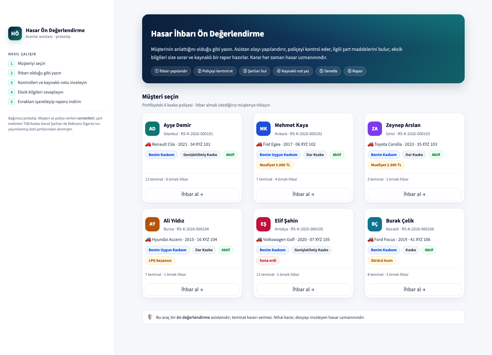
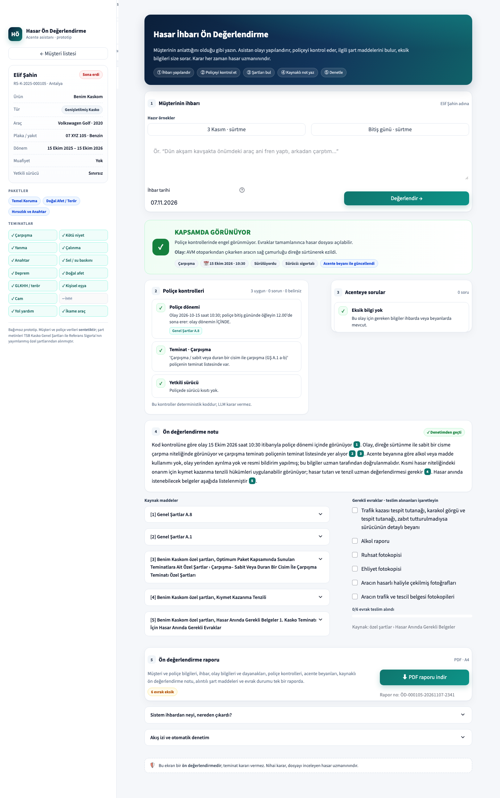
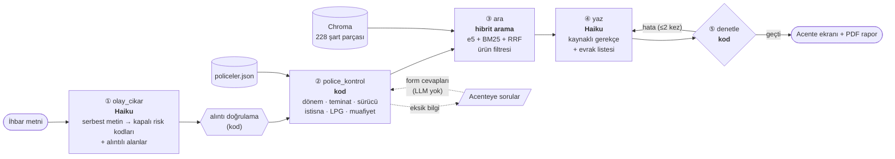
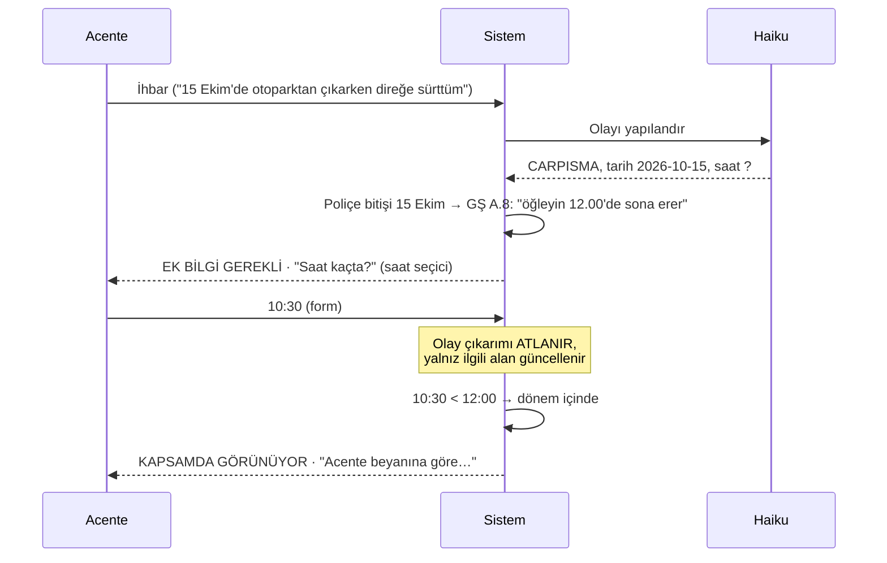

# Kasko Hasar Ön Değerlendirme Asistanı

Acentenin, müşterinin serbest metinle anlattığı hasarı **poliçe ve şart metinleriyle** karşılaştırıp kaynaklı bir ön değerlendirme almasını sağlayan prototip. Sistem eksik bilgileri acenteye soruyor, cevaplarla değerlendirmeyi güncelliyor ve indirilebilir bir PDF rapor hazırlıyor.

> **Karar vermez.** Çıktı bir ön değerlendirmedir; teminat kararı hasar uzmanınındır. Müşteri ve poliçe verileri **sentetiktir**. Şart metinleri TSB Kasko Genel Şartları ile Referans Sigorta'nın yayımlanmış özel şartlarından (Benim Kaskom, Benim Uygun Kaskom) alınmıştır. Bağımsız bir prototiptir.

| Ana ekran | Sonuç ekranı |
|---|---|
|  |  |

Örnek rapor: [`docs/ornek-rapor.pdf`](docs/ornek-rapor.pdf)

---

## Problem

Müşteri *"Sağanakta araç park hâlindeydi, sabah motor bölmesine kadar su dolmuştu"* der. Acentenin bu cümleden şu soruları cevaplaması gerekir:

- Bu olay hangi teminata girer, poliçede o teminat var mı?
- Olay tarihi poliçe dönemi içinde mi? Muafiyet var mı?
- Şartlarda hangi istisnalar devreye girebilir?
- Hangi bilgiler eksik, hangi evraklar istenmeli?

Bunun için üç katmanlı bir metne bakmak gerekiyor: **Genel Şartlar** (herkese aynı) → **ürünün özel şartları** → **müşterinin poliçesi** (paketler, teminat listesi, sürücü kısıtı...). Bu asistan bu üç katmanı birleştiriyor.

## Mimari



**Görev paylaşımı.** Temel ilke şu: Cevabı kayıtta hazır olan hiçbir şey LLM'e sorulmaz.

| İş | Kim yapıyor | Neden |
|---|---|---|
| Serbest metni yapılandırmak (risk kodu, tarih, sürücü, alkol…) | Haiku | Dil anlama gerektiriyor |
| Poliçe dönemi, teminat listesi, sürücü kısıtı, LPG, muafiyet | **Kod** | Cevap poliçe kaydında var. LLM'e sormak halüsinasyon riski ekler, tekrarlanabilirliği ve denetlenebilirliği bozar |
| Genel etiket (kapsamda / kapsam dışı / uzman / ek bilgi) | **Kod** | Ekrandaki kontrol paneli ile yazılı not çelişemesin |
| Kontrollerin açıklanması, şart maddelerine atıf | Haiku | Kodun bulduğunu acentenin anlayacağı dile çevirmek |
| Atıf, alıntı, evrak ve karar dili denetimi | **Kod** | Daha küçük model + doğrulama katmanı |
| Acente cevaplarını işlemek | **Kod** | Form alanları doğrudan ilgili alana yazılıyor |

### Acente cevap döngüsü



## Güvenlik ağları

1. **Üç değerli alanlar ve zorunlu alıntı.** Alkol, ehliyet, olay yerini terk gibi alanlar `evet / hayir / bilinmiyor` değerlerinden birini alıyor. `evet` ya da `hayir` diyen her alan ihbardan **birebir alıntı** göstermek zorunda. Kod alıntıyı metinde arıyor, bulamazsa alanı `bilinmiyor` yapıyor. *Müşterinin söz etmediği şey "hayır" sayılmaz.*
2. **İlgililik kuralı.** Hangi sorunun sorulacağı olay türüne bağlı. Araç park hâlindeyken su bastıysa alkol ve sürücü sorulmaz; sürülürken olduysa sorulur. Sürücüye bağlı istisnalar park hâlindeki araçta uygulanmaz ("birisi çarpıp kaçmış" cümlesi bizim sürücümüzün olay yerini terk ettiği anlamına gelmez).
3. **Ürün filtresi.** Benim Uygun Kaskom müşterisinin aramasında Benim Kaskom'un deprem klozu hiç getirilmez.
4. **Taslak denetimi.** Kod şunları kontrol ediyor: atıf ID'leri verilen parçalardan mı, alıntılar şart metninde birebir var mı, evraklar "Hasar Anında Gerekli Belgeler" bölümünde geçiyor mu, kesin karar dili ("ödenmez", "reddedilir") kullanılmış mı, park hâlindeki araç için sürücü evrakı istenmiş mi. Hata varsa taslak, hata listesiyle birlikte geri gönderiliyor (en fazla 2 kez).

## Arama

- **Parçalama:** Madde/bent bazında; her parçanın başında bağlam yolu var ("Genel Şartlar › A.5 Teminat Dışında Kalan Zararlar › 5.5"). Toplam 228 parça, hepsi 350 token'ın altında.
- **Hibrit arama:** `intfloat/multilingual-e5-base` (anlam) + BM25 (kelime; Türkçe için ilk 5 harf önek eşleşmesi, "alkollüydüm" → "alkol") → Reciprocal Rank Fusion (k=60).
- **Kardeş genişletme:** Token sınırı yüzünden bölünmüş bir bendin bir parçası gelirse, komşu parçası da otomatik ekleniyor.
- **Sorgu yeniden yazma:** Müşterinin cümlesiyle ("su dolmuş") Sel Klozu ilk 6 sonuca girmedi. Haiku'nun ürettiği sözleşme diliyle ("sel ve su baskını hasarı") 1. sıraya çıktı. Arama bu yüzden ihbarın kendisiyle değil, LLM'in sözleşme diline çevirdiği sorgularla yapılıyor.

## Değerlendirme

**Birim testleri (LLM yok, ~20 sn):** 39 test.

```bash
.venv/bin/python -m pytest -q
```

**Uçtan uca değerlendirme seti (20 senaryo, Haiku ile).** Metin her seferinde farklı çıktığı için "beklenen metne eşit mi" diye bakılmıyor. Bunun yerine **ölçülebilir özellikler** puanlanıyor:

| Metrik | Ne ölçüyor | Sonuç |
|---|---|---|
| Etiket doğruluğu | Kodun etiketi beklenenle aynı mı | 20/20 |
| Risk kodu doğruluğu | Haiku doğru teminat koduna eşledi mi | 20/20 |
| Atıf recall | Beklenen şart maddeleri gerekçede geçiyor mu | 12/12 |
| Soru doğruluğu | Gereken sorular soruldu, gereksizler sorulmadı mı | 20/20 |
| Denetimden geçen | Son taslak kod denetimini geçti mi | 20/20 |

```bash
.venv/bin/python -m eval.calistir              # tümü (~2 dk, birkaç cent)
.venv/bin/python -m eval.calistir ali_lpg      # tek senaryo
```

**Eval'in bulduğu hatalar:**

| Hata | Kök neden | Çözüm |
|---|---|---|
| "Birisi aracıma **çarpıp kaçmış**" → A.5/5.10 (yeri terk) istisnası işaretlendi | Alıntı doğruydu ama karşı tarafın eylemi bizim sürücümüze atfedildi | Kod: Park hâlindeki araçta sürücü istisnaları uygulanmıyor |
| "Anahtarla **çizmişler**" bir koşuda kötü niyet, diğerinde çalınma olarak sınıflandırıldı | LLM deterministik değil; model risk kodlarının yalnız adlarını görüyordu | Prompt'a kod tanımları eklendi |
| "Depremde duvar çöktü" → DEPREM + CARPISMA (regresyon) | Bir önceki düzeltmede yazılan "duvarla çarpışma" tanımı | "Hasarın asıl nedenini seç" kuralı; etkilenen senaryolar 3 kez koşuldu |

> **Dürüst not:** Bu 20 senaryo üzerinde hata ayıklandığı için set artık bir **geliştirme seti** sayılır; %100 sonucu bu yüzden iyimserdir. Gerçek performans için ayrı bir test seti ve hasar uzmanlarının etiketlediği gerçek ihbarlar gerekir.

## Kurulum ve çalıştırma

```bash
uv venv --python 3.11 .venv
uv pip install --python .venv/bin/python -r requirements.txt
echo "ANTHROPIC_API_KEY=..." > .env

.venv/bin/streamlit run app.py        # arayüz: http://localhost:8501
```

İlk değerlendirmede embedding modeli iner ve 228 parça vektöre çevrilir (~1 dk). Dizin `data/chroma/` altında saklanıyor; parçalar değişince parmak izi sayesinde kendiliğinden yeniden kuruluyor.

Komut satırı araçları:

```bash
.venv/bin/python -m src.kasko.belgeler                                   # parçalama istatistikleri
.venv/bin/python -m src.kasko.arama benim_uygun_kaskom "araç yandı"       # hibrit arama
.venv/bin/python -m src.kasko.police                                     # poliçe kontrolleri (LLM yok)
.venv/bin/python -m src.kasko.degerlendirme RS-K-2026-000102 "ihbar..."   # uçtan uca
```

## Proje yapısı

```
app.py                     Streamlit acente ekranı (ana ekran, değerlendirme, sorular, evrak, rapor)
config.yaml                Belgeler ve arama ayarları
data/
  kaynak/                  TSB Genel Şartlar + Referans özel şartlar (PDF)
  policeler.json           6 sentetik poliçe + teminat kodları
src/kasko/
  belgeler.py              PDF → madde/bent parçaları (bağlam başlıklı)
  arama.py                 e5 + BM25 + RRF, ürün filtresi, kardeş genişletme
  olay.py                  Haiku ile olay çıkarımı, alıntı doğrulama, ilgililik kuralı, acente beyanları
  police.py                Deterministik poliçe kontrolleri
  degerlendirme.py         LangGraph akışı, yazım ve denetim döngüsü
  sunum.py                 Arayüz ve raporun ortak yardımcıları
  rapor.py                 PDF rapor (fpdf2 + Noto Sans)
tests/                     39 birim testi
eval/                      20 senaryo + özellik tabanlı puanlama
assets/fonts/              Noto Sans (SIL OFL)
```

## Teknoloji

Claude Haiku 5.5 (yapılandırılmış çıktı: `messages.parse` + Pydantic) · LangGraph · Chroma · sentence-transformers (multilingual-e5-base) · Streamlit · fpdf2 · pytest

## Sınırlamalar ve sonraki adımlar

- **Veri:** Poliçeler sentetik, paket-teminat eşleşmesi özel şartlardaki ürün tanımlarından kurgulandı. Gerçek bir kurulumda poliçe sistemine bağlanmalı.
- **Ölçüm:** Ayrı bir test seti, hasar uzmanlarının etiketlediği gerçek ihbarlar ve pass^k ile kararlılık ölçümü.
- **Kapsam:** Hasar fotoğrafı (görsel model), hasar tutarı tahmini, mükerrer/şüpheli ihbar işaretleri.
- **Entegrasyon:** Araçları (`poliçe getir`, `şart ara`, `kontrol et`) bir MCP sunucusuyla açmak; böylece aynı yetenekler farklı asistanlardan kullanılabilir.
- **Uyum:** KVKK (ihbar metninde kişisel veri), denetim izi saklama, model çıktılarının insan onayı ile kayda geçmesi.
